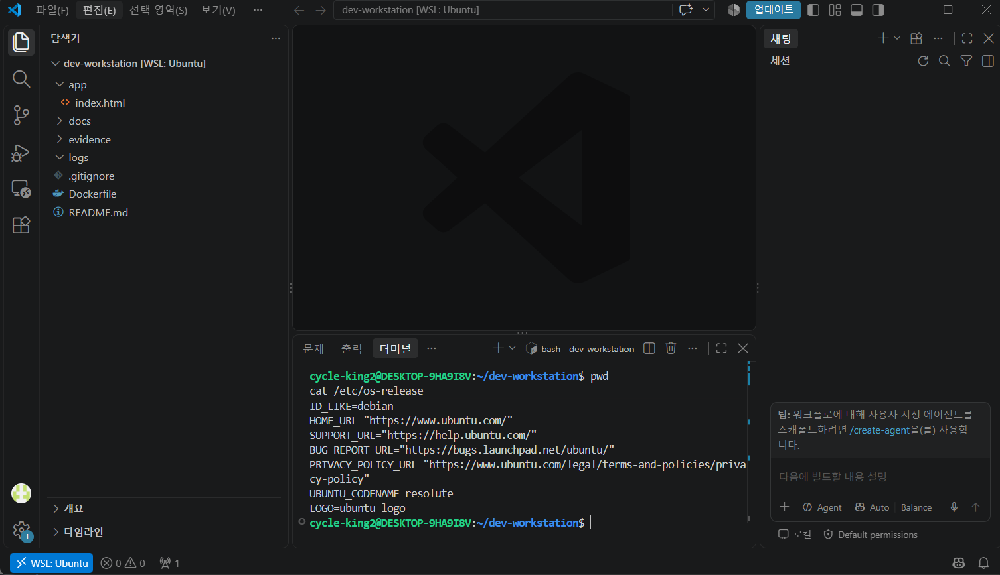
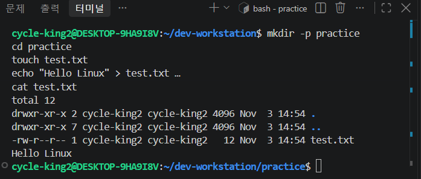
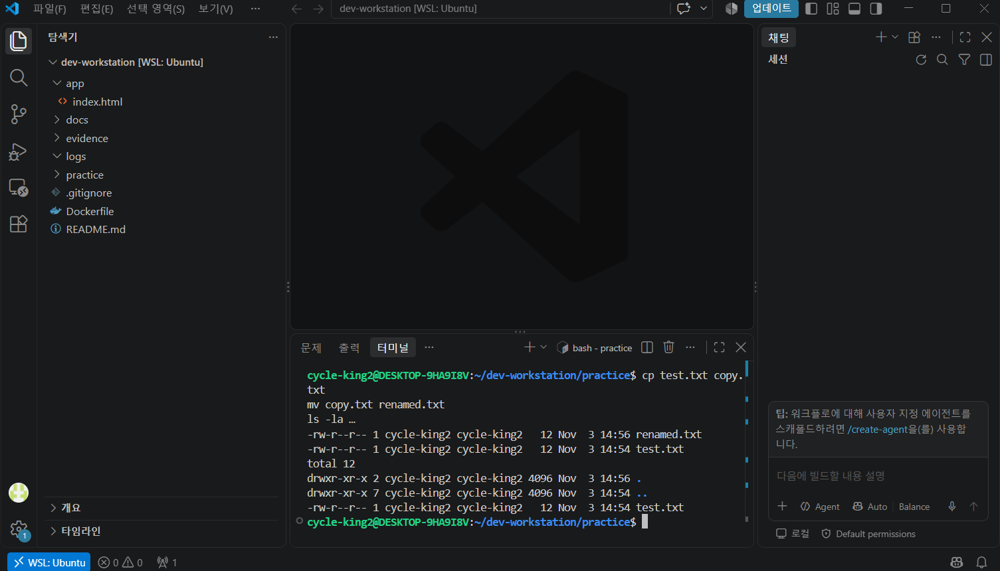
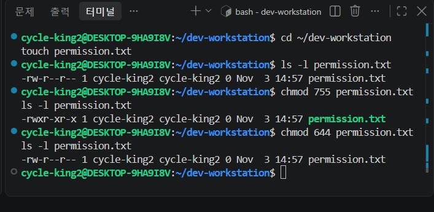
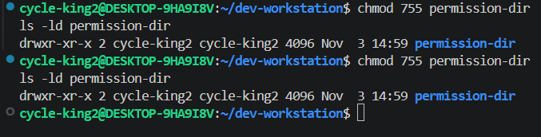
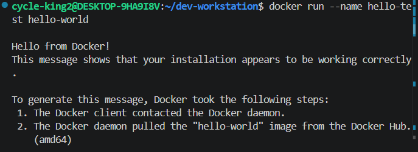
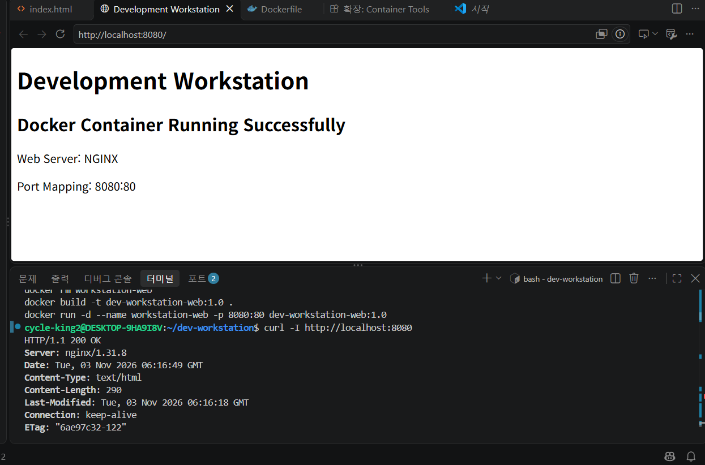
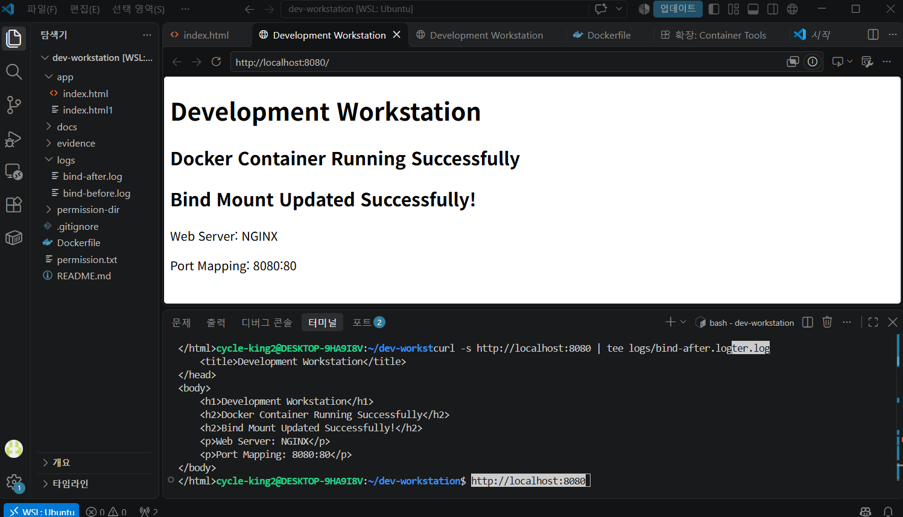

# KDJ-E1-1

개발 워크스테이션 구축: Linux CLI, WSL Ubuntu, Docker 및 Git/GitHub 실습

목차

- [1. 프로젝트 소개](#1-프로젝트-소개)
- [2. 기술 스택 및 개발 환경](#2-기술-스택-및-개발-환경)
- [3. 실습 및 실행 방법](#3-실습-및-실행-방법)
- [4. 프로젝트 구조](#4-프로젝트-구조)
- [5. 트러블슈팅](#5-트러블슈팅)
- [6. 로그 및 증빙 자료](#6-로그-및-증빙-자료)
- [7. 실습 확인 결과](#7-실습-확인-결과)

---

### 1. 프로젝트 소개

> Windows에서 WSL Ubuntu를 활용해 Linux 개발 환경을 구성하고, Docker 기반 NGINX 웹 서버와 Git/GitHub를 다루는 실습입니다. 파일 권한, 포트 매핑, 바인드 마운트와 볼륨 영속성을 학습하고 관련 기록을 정리합니다.

주요 실습 내용

- Linux CLI를 이용한 파일·디렉터리 관리 및 `chmod` 권한 설정
- Docker 이미지 빌드 및 컨테이너 관리
- NGINX 웹 서버 실행과 `8080:80` 포트 매핑
- 바인드 마운트를 이용한 HTML 변경 반영 및 볼륨 데이터 보존 확인
- Git 커밋과 GitHub 원격 저장소 연결, 인증 오류 대응

저장소: [Gonyak004/KDJ-E1-1](https://github.com/Gonyak004/KDJ-E1-1)

이 문서는 이전 실습 대화, 로컬 파일 및 첨부 스크린샷 8장을 기준으로 작성했습니다. 아래 명령어는 재현·확인용이며, 명령어가 기재되어 있다는 사실만으로 실행 성공을 의미하지는 않습니다.

---

### 2. 기술 스택 및 개발 환경

| 구분 | 사용 환경 및 역할 |
| --- | --- |
| 호스트 | Windows |
| Linux 환경 | WSL Ubuntu — Linux CLI 및 권한 실습 |
| 컨테이너 | Docker — 이미지, 컨테이너, 마운트 관리 |
| 웹 서버 | NGINX (`nginx:alpine`) |
| 웹 콘텐츠 | `app/index.html` |
| 버전 관리 | Git / GitHub |

Windows 작업 경로는 `C:\github\KDJ-E1-1`입니다. 아래 명령어는 WSL Ubuntu Bash 기준이며, 해당 폴더는 `/mnt/c/github/KDJ-E1-1`로 접근합니다. 이전 대화의 `~/dev-workstation`은 별도의 WSL 작업 경로이므로 실제 파일이 있는 폴더를 사용하셔야 합니다.

WSL 배포판은 Windows PowerShell에서 `wsl --list --verbose`로 확인하실 수 있습니다. 추가 검증 로그에서 Ubuntu 26.04.1 LTS, WSL2 커널 6.18.54.1, Docker Engine 29.9.2를 확인했습니다.

---

### 3. 실습 및 실행 방법

#### Linux CLI 및 파일 권한

```bash
cd /mnt/c/github/KDJ-E1-1
pwd
whoami
uname -a
ls -la
mkdir -p permission-dir
touch permission.txt
chmod 644 permission.txt
chmod 755 permission-dir
ls -l permission.txt
ls -ld permission-dir
```

`644`는 소유자 읽기·쓰기, 그룹과 기타 사용자 읽기 권한입니다. `755`는 소유자 읽기·쓰기·실행, 그룹과 기타 사용자 읽기·실행 권한입니다. 디렉터리의 실행 권한은 디렉터리 접근에 사용됩니다.

Windows 드라이브(`/mnt/c`)에서는 WSL 마운트 설정과 Windows 권한에 따라 `chmod` 반영 방식이 달라질 수 있습니다. 첨부 화면에서는 WSL의 ~/dev-workstation에서 파일 권한 755 → 644 변경과 디렉터리 755 권한의 실제 출력을 확인했습니다.

#### Docker 환경 확인 및 컨테이너 관리

```bash
docker --version
docker info
docker images
docker ps -a
docker volume ls
```

첨부 화면에서 hello-world 실행 후 Hello from Docker! 출력을 확인했습니다. 촬영 당시 컨테이너 실행이 확인되며 현재 상태는 위 명령으로 확인합니다. Docker Desktop을 사용하신다면 Ubuntu와 WSL 통합 설정도 확인합니다.

#### Dockerfile

현재 Dockerfile의 내용입니다.

```dockerfile
FROM nginx:alpine

LABEL description="Development Workstation Web Server"

COPY app/index.html /usr/share/nginx/html/index.html

EXPOSE 80

CMD ["nginx", "-g", "daemon off;"]
```

이미지 빌드 및 실행 예시입니다. 동일한 컨테이너 이름이나 호스트 포트가 이미 사용 중이면 다른 이름·포트를 지정합니다.

```bash
docker build -t kdj-e1-1-web .
docker run -d --name kdj-e1-1-web -p 8080:80 kdj-e1-1-web
curl -I --max-time 10 http://localhost:8080
docker logs kdj-e1-1-web
```

브라우저에서 `http://localhost:8080`으로 접속합니다. `8080:80`은 호스트의 8080번 포트를 컨테이너의 80번 포트에 연결합니다. `EXPOSE 80`만으로 호스트 포트가 공개되지는 않습니다. HTTP 응답의 정상 확인 기준은 `200 OK`입니다.

```bash
docker stop kdj-e1-1-web
docker start kdj-e1-1-web
```

#### 바인드 마운트

호스트의 `app` 폴더를 NGINX 문서 경로에 연결합니다. 앞의 웹 컨테이너를 중지하여 8080번 포트를 확보한 뒤 실행합니다.

```bash
docker stop kdj-e1-1-web
docker run -d --name kdj-e1-1-bind -p 8080:80 \
  --mount type=bind,source="$(pwd)/app",target=/usr/share/nginx/html,readonly \
  nginx:alpine
```

호스트의 `app/index.html`을 수정한 후 `curl http://localhost:8080`으로 변경 내용을 확인합니다. 이미지 재빌드 없이 호스트 파일을 제공하며, 컨테이너에서는 읽기 전용으로 연결됩니다.

기존 `logs/bind-before.log`에는 없던 `Bind Mount Updated Successfully!` 문구가 `logs/bind-after.log`와 현재 HTML에 존재합니다. 저장된 응답 내용의 차이와 첨부 화면의 브라우저·curl 변경 반영을 확인했으며, 추가 검증에서 /mnt/c/github/KDJ-E1-1/app의 읽기 전용 바인드 마운트(Type: bind, RW: false) 설정도 확인했습니다.

#### Docker 볼륨 영속성

다음은 별도 테스트 볼륨에 데이터를 쓰고, 작성 컨테이너 종료 후 새 컨테이너에서 다시 읽는 재현 예시입니다.

```bash
mkdir -p logs
docker volume create kdj-e1-1-persistence-check
docker run --rm -v kdj-e1-1-persistence-check:/data alpine \
  sh -c 'echo "Docker Volume Persistence Test" > /data/test.txt; cat /data/test.txt' \
  > logs/volume-before.log
docker run --rm -v kdj-e1-1-persistence-check:/data alpine \
  cat /data/test.txt > logs/volume-after.log
diff -s logs/volume-before.log logs/volume-after.log
```

정상적으로 실행되면 두 파일의 내용이 일치합니다. 컨테이너가 종료·삭제되어도 이름 있는 볼륨은 별도로 삭제하기 전까지 데이터를 보관합니다. 위 예시를 재실행하면 같은 이름의 기존 로그가 갱신됩니다.

현재 두 로그에는 동일한 `Docker Volume Persistence Test` 문구가 저장되어 있습니다. 추가 검증 로그에서는 작성 컨테이너를 삭제한 후 새 컨테이너가 같은 볼륨에서 데이터를 읽고 내용 비교를 통과한 과정까지 확인했습니다.

#### Git / GitHub 연동

현재 로컬 `origin`의 fetch/push 주소는 모두 `https://github.com/Gonyak004/KDJ-E1-1.git`로 확인했습니다.

```bash
git remote -v
git status
git log -1 --oneline
```

변경 내용을 확인하신 뒤 아래 순서로 반영합니다.

```bash
git add README.md evidence/
git diff --cached
git commit -m "docs: document development workstation practice"
git push origin main
```

---

### 4. 프로젝트 구조

로컬 주요 파일과 이번 문서에 첨부한 증빙 폴더의 구성입니다.

```text
KDJ-E1-1/
├── Dockerfile
├── README.md
├── .gitignore
├── permission.txt
├── permission-dir/
├── app/
│   └── index.html
├── docs/
├── evidence/                 # 첨부 스크린샷 8장
└── logs/
    ├── bind-before.log
    ├── bind-after.log
    ├── volume-before.log
    ├── volume-after.log
    └── final-verification.log
```

`evidence/`에는 아래 스크린샷 8장을 첨부했습니다.

---

### 5. 트러블슈팅

#### 1. 빈 Dockerfile로 인한 빌드 문제

- 문제: 실습 중 Dockerfile에 내용을 포함하고 있었으나, 이미지 빌드에 내용이 없다는 에러를 확인 후, 재시도 및 필요한 지시문이 다시 넣어 해결하였습니다.

- 조치: NGINX 기본 이미지, HTML 복사 경로, 포트 및 실행 명령을 재시도하는 방식으로 대응했습니다.

- 현재 확인: 로컬 Dockerfile에는 위 내용이 들어 있습니다. 첨부 화면의 NGINX 응답에 더해 추가 검증 로그에서 이미지 내보내기·태그 지정과 빌드 완료까지 확인했습니다.

- 확인 방법: `cat Dockerfile`로 내용을 확인하고 `docker build -t kdj-e1-1-web .`의 종료 결과를 확인할 수 있습니다.

#### 2. 잘못된 GitHub 계정 인증으로 인한 403 오류

이전 대화에서 다음 오류가 확인되었습니다.

```text
remote: Permission to Gonyak004/KDJ-E1-1.git denied to SeoyoungShim.
fatal: unable to access 'https://github.com/Gonyak004/KDJ-E1-1.git/': The requested URL returned error: 403
```

- 원인: 저장소 소유자는 `Gonyak004`였지만 Git 인증에는 `SeoyoungShim` 계정이 사용되었습니다. 커밋 작성자 설정과 GitHub 인증 계정은 서로 다른것을 확인했습니다.

- 대응 절차: `git config --show-origin --get-all credential.helper`로 인증 도구를 확인하고, 해당 인증 도구에서 본인 계정 `Gonyak004`로 로그인한 뒤 다시 push했습니다. 

- >공용 PC의 다른 사용자 인증정보가 저장되어 추후 pc 사용에있어 꼭 유의해야할 듯 싶습니다...

- 현재 확인: 로컬 원격 주소는 본인 저장소로 설정되어 있습니다. 재인증 및 push 성공 출력은 추가 확인이 필요했습니다.

- 별도 정리: 이전 사용자인 `SeoyoungShim` 계정에 잘못 생성된 저장소는 소유자와 협의하여 정리하도록 하겠습니다.

---

### 6. 로그 및 증빙 자료

| 자료 | 확인 내용 | 상태 |
| --- | --- | --- |
| [bind-before.log](logs/bind-before.log) | 변경 전 HTML | 파일 확인 |
| [bind-after.log](logs/bind-after.log) | 변경 확인 문구가 추가된 HTML | 파일 확인 |
| [volume-before.log](logs/volume-before.log) | 저장 데이터 문구 | 파일 확인 |
| [volume-after.log](logs/volume-after.log) | 이전 로그와 같은 문구 | 내용 일치 확인 |
| [final-verification.log](logs/final-verification.log) | 시스템·Docker·Git 확인 명령어 | 실행 출력이 아닌 명령어 본문만 저장됨 |
| `evidence/` | Linux·권한·Docker·웹 응답·HTML 변경 화면 | 스크린샷 8장 첨부 |
| [추가 검증 로그](logs/verification-20261103-162726.log) | 빌드·볼륨 재사용·마운트·HTTP 응답 | 실제 실행 결과 확인 |


#### 실습 화면 증빙

촬영 당시 화면에서 확인되는 내용을 정리했습니다.

##### 터미널 실습

>WSL: Ubuntu 연결과 Ubuntu OS 정보 출력을 확인했습니다.



##### 리눅스 파일 생성

>mkdir, touch, echo, cat을 이용한 파일 생성과 Hello Linux 출력을 확인했습니다.



##### 파일 삭제 복사 변경

>cp와 mv 명령, renamed.txt가 있는 목록과 이후 없는 목록을 확인했습니다. 삭제 명령 자체는 표시되지 않습니다.



##### 파일 권한 변경

>chmod 755 적용 후 -rwxr-xr-x, chmod 644 적용 후 -rw-r--r-- 출력을 확인했습니다.



##### 디렉토리 권한 변경

>chmod 755 적용 후 permission-dir의 drwxr-xr-x 출력을 확인했습니다.



##### Docker 로그확인

>hello-world 실행 후 Hello from Docker! 출력을 확인했습니다.



##### html 이미지 빌드

>localhost:8080 웹 화면과 HTTP/1.1 200 OK, Server: nginx/1.31.8 출력을 확인했습니다. 빌드 명령은 보이지만 빌드 완료 로그는 표시하지 않았습니다.



##### html 바인드 마운트 변경

>브라우저와 curl 응답에 Bind Mount Updated Successfully! 문구가 반영되었습니다.



기존 `final-verification.log`에는 명령어 본문만 있으므로, 실제 실행 결과가 담긴 `verification-20261103-162726.log`를 최종 증빙으로 사용합니다. 아래는 필요 시 추가 출력을 수집하는 예시입니다.

```bash
{
  uname -a
  whoami
  ls -l permission.txt
  ls -ld permission-dir
  docker --version
  docker info
  docker images
  docker ps -a
  docker volume ls
  curl -I --max-time 10 http://localhost:8080
  grep 'Bind Mount Updated Successfully' logs/bind-after.log
  diff -s logs/volume-before.log logs/volume-after.log
  git remote -v
  git status
  git log -1 --oneline
} > "logs/verification-output-$(date +%Y%m%d-%H%M%S).log" 2>&1
```

로그에는 오류 출력도 함께 저장됩니다. HTTP 응답, Docker 연결, 권한 및 Git 상태를 항목별로 확인합니다. Linux 권한, Docker 실행, 웹 접속 및 HTML 변경 화면은 첨부했습니다. 볼륨 재사용 과정은 추가 실행 로그로 확인했습니다. GitHub 최종 반영은 별도 확인이 필요합니다. 인증 토큰이나 비밀번호는 증빙에 포함하지 않습니다.

---

### 7. 실습 확인 결과

#### [검증 로그](logs/verification-20261103-162726.log)

| 확인 항목 | 실행 결과 |
| --- | --- |
| WSL / Ubuntu | WSL2 커널 및 Ubuntu 26.04.1 LTS 출력 확인 |
| Docker | 클라이언트·서버 29.9.2 연결 확인 |
| NGINX 이미지 빌드 | COPY 수행, 이미지 내보내기 및 태그 지정 완료 |
| 볼륨 영속성 | 작성 컨테이너 삭제 후 새 컨테이너에서 같은 볼륨의 데이터 재조회·내용 비교 통과 |
| 바인드 마운트 | app → /usr/share/nginx/html, Type: bind, RW: false 확인 |
| HTTP 응답 | 임시 포트 60684에서 HTTP/1.1 200 OK 및 HTML 본문 확인 |
| NGINX 로그 | HEAD·GET 요청의 200 응답 기록 확인 |
| Git 원격 | Gonyak004/KDJ-E1-1 fetch·push 주소 확인 |